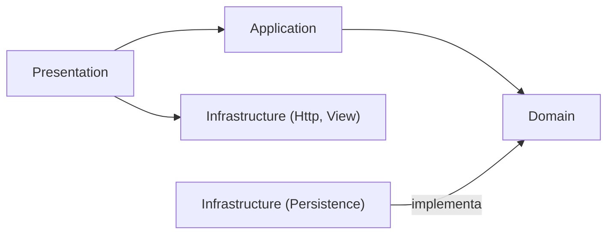
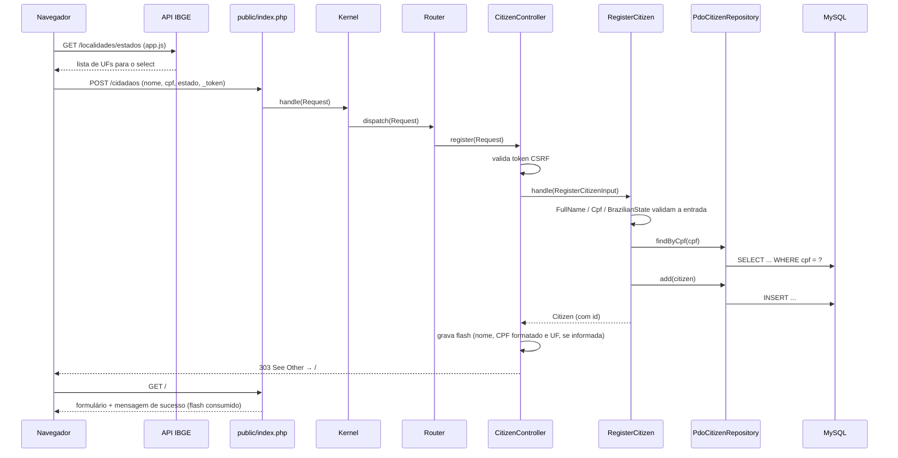

# Arquitetura

Este documento explica como o código está organizado e por quê. Para rodar o
projeto, veja o [README](../README.md).

## Visão geral

A aplicação usa uma **arquitetura em camadas com inversão de dependência**,
inspirada em Clean Architecture e Hexagonal (Ports & Adapters), com alguns
padrões táticos de DDD (Value Object, Repository).

A regra central: **as dependências apontam sempre para dentro, em direção ao
domínio.** O domínio não sabe que existem HTTP, MySQL ou templates. Por isso
as regras de negócio podem ser testadas isoladamente, e trocar um detalhe
técnico (por exemplo, o banco) não exige mudar as regras.

## Camadas

### Domain (`src/Domain`)

O coração do sistema: as regras de negócio, em PHP puro, sem dependências.

| Elemento | Papel |
|---|---|
| `Shared/ValueObject/Cpf` | Remove a máscara, valida tamanho, sequências repetidas e os dois dígitos verificadores. Expõe `value()` (só dígitos) e `formatted()` (`000.000.000-00`). |
| `Shared/ValueObject/FullName` | Normaliza espaços, exige nome e sobrenome, limita a 150 caracteres e aceita só letras (com acentos), espaço, apóstrofo e hífen. Expõe `value()` e `initials()` (as iniciais do avatar na busca). |
| `Shared/ValueObject/BrazilianState` | Enum com as 27 UFs. `fromCode()` aceita a sigla em qualquer caixa e rejeita o que não for uma UF. |
| `Citizen/Citizen` | Entidade imutável (id, nome, CPF, estado, data de criação). |
| `Citizen/CitizenRepository` | **Porta**: interface que descreve o que o domínio precisa da persistência. |
| `Exception/*` | Erros de negócio. Todos estendem uma `DomainException` base, cuja mensagem pode ser exibida ao usuário. |

Os value objects se validam na construção: **um `Cpf` inválido não chega a
existir**. Assim, qualquer código que receba um `Cpf` pode confiar nele sem
revalidar.

### Application (`src/Application`)

Os casos de uso: o que o sistema faz, orquestrando o domínio. Cada caso de uso
é uma classe com um único método `handle()`.

- **`RegisterCitizen`:** cria os value objects a partir do DTO
  `RegisterCitizenInput`, garante que o CPF ainda não existe e persiste.
- **`SearchCitizens`:**
  - Rejeita termo vazio.
  - Se o termo tem 11 dígitos (com ou sem máscara), busca por CPF.
  - Caso contrário, busca por nome (parcial e sem diferenciar maiúsculas).

Esta camada conhece só o domínio. Ela recebe o repositório pelo construtor,
como interface, e não sabe se do outro lado há MySQL ou um array em memória.

### Infrastructure (`src/Infrastructure`)

Os detalhes técnicos, que implementam as portas do domínio ou dão suporte à
entrada HTTP.

| Pasta | Conteúdo |
|---|---|
| `Persistence` | **Adaptadores** do repositório: `PdoCitizenRepository` (MySQL, só prepared statements) e `InMemoryCitizenRepository` (testes). `Connection` cria o PDO. |
| `Http` | `Request`, `Response`, `Router`, `Session` (flash e CSRF) e `HttpException`: um mini-framework próprio, já que o desafio proíbe frameworks. |
| `View` | `ViewRenderer` (templates em PHP puro e URLs versionadas dos assets via `asset()`) e o helper `e()` de escape. |
| `Config` | Leitura das variáveis de ambiente. |
| `Container.php` | Composição manual de dependências: o único lugar que dá `new` nos serviços. |

### Presentation (`src/Presentation`)

- **`Kernel`:** define as rotas e é o ponto central de tratamento de erros.
  Recebe uma `Request`, devolve uma `Response` e nunca deixa uma exceção
  escapar. O `public/index.php` só cria o `Kernel` pelo `Container`, chama
  `handle()` e envia a resposta.
- **`Controller/CitizenController`:** um controller fino. Lê a requisição,
  chama o caso de uso e escolhe a resposta, sem nenhuma regra de negócio.

O `Kernel` recebe o controller por uma closure e só o cria quando uma rota é
atendida. Assim, uma falha ao montá-lo (por exemplo, o banco fora do ar)
acontece dentro do `try` e vira a página 500, como qualquer outro erro.

## Fluxo de uma requisição

Exemplo: cadastro com sucesso.

Esse é o **Post/Redirect/Get**: como a resposta ao POST é um redirect,
recarregar a página não reenvia o cadastro.

## Integração com o IBGE

A lista de estados vem da API de Localidades do IBGE, chamada pelo
`public/assets/js/app.js`, e não pelo PHP. Essa API é pública, gratuita,
dispensa chave e responde com CORS liberado. O `<select>` começa só com
"Selecione o estado"; o JS adiciona as 27 UFs (sigla como valor, nome como
texto) e, depois de um envio com erro, reseleciona a UF escolhida a partir do
atributo `data-selected` que o servidor devolve.

A integração é **só de experiência de uso**:

- **O estado é opcional.** O enunciado exige apenas nome e CPF, então o estado
  é um dado extra. O caso de uso trata o campo vazio como "não informado"
  (`null`), e a busca mostra "Não informado" nesse caso.
- **O domínio não depende da API.** A UF enviada é validada pelo enum
  `BrazilianState`, então uma requisição forjada com `XX` vira erro 422, com ou
  sem IBGE.
- **Uma falha não bloqueia o cadastro.** Se a API cair ou responder com erro,
  o campo avisa que não foi possível carregar os estados e que é possível
  cadastrar sem ele.

## Tratamento de erros

| Situação | Onde é tratada | Resultado |
|---|---|---|
| Nome, CPF ou estado inválido, CPF duplicado | Controller captura `DomainException` e descobre o campo pelo tipo da exceção | Formulário com status 422, campos preenchidos e a mensagem abaixo do campo com erro |
| Termo de busca vazio | Controller captura `EmptySearchTermException` | Mensagem de validação abaixo do campo de busca, sem consultar o banco |
| Token CSRF inválido, rota inexistente, método errado | `Kernel` captura `HttpException` | Página de erro com 400, 404 ou 405 |
| Qualquer outra exceção | `Kernel` captura `Throwable` | Log do erro e página 500 genérica, sem stack trace |

**CPF duplicado tem duas barreiras:**
- O caso de uso consulta `findByCpf` antes de inserir.
- A constraint `UNIQUE` do banco cobre duas requisições simultâneas. O
  repositório converte o erro MySQL 1062 na mesma
  `CitizenAlreadyExistsException`.

## Segurança

- **Saída:** todo dado dinâmico nos templates passa por `e()`
  (`htmlspecialchars`).
- **CSRF:** token por sessão nos formulários POST, comparado com `hash_equals`.
- **SQL:** apenas prepared statements, com `EMULATE_PREPARES=false`. Na busca
  por nome, `%`, `_` e o caractere de escape são escapados, então o termo é
  tratado como texto literal.
- **Validação:** o servidor é a fonte da verdade. O JavaScript repete o
  algoritmo do CPF só para dar feedback enquanto o usuário digita, e a lista
  de estados do IBGE só preenche o `<select>`.
- **Credenciais:** vêm de variáveis de ambiente, nunca do código.

## Testes

A separação em camadas define a estratégia:

- **Unitários (`tests/Unit`):** testam value objects, entidade e casos de uso
  com o `InMemoryCitizenRepository`. Não usam banco e rodam em milissegundos.
- **HTTP (`tests/Unit/Presentation`):** passam requisições montadas à mão
  pelo `Kernel` real, com controller, templates, repositório em memória e uma
  `Session` sobre um array comum. A `Session` recebe o array por referência
  (`$_SESSION` em produção), então os testes não precisam de `session_start()`.
  Cobrem rotas, status, redirect do PRG, flash message exibida uma única vez,
  CSRF, mensagens de erro, escape da saída, 404, 405 e a página 500 genérica.
- **Integração (`tests/Integration`):** testam o `PdoCitizenRepository`
  contra um banco MySQL real e separado (`citizens_test`). Cobrem o que só o
  banco valida: collation (busca sem diferenciar maiúsculas e acentos),
  escape do `LIKE` e conversão do erro de duplicidade.

## Simplificações conscientes

Para um projeto deste tamanho, alguns pontos ficaram mais simples do que uma
Clean Architecture estrita pediria:

- **O controller usa direto os objetos HTTP da infraestrutura** (`Request`,
  `Response`, `Session`), sem uma interface no meio. Uma abstração própria
  para eles não traria ganho aqui.
- **Os casos de uso não têm interfaces de entrada:** o controller chama as
  classes concretas.
- **`InMemoryCitizenRepository` fica em `src/`**, ao lado do adaptador PDO,
  por ser uma implementação completa da porta. Hoje só os testes o usam.
- **`createdAt` vem de `new DateTimeImmutable()` no caso de uso.** Uma
  abstração de relógio (`ClockInterface`) só valeria a pena se algum teste
  dependesse do horário exato.
